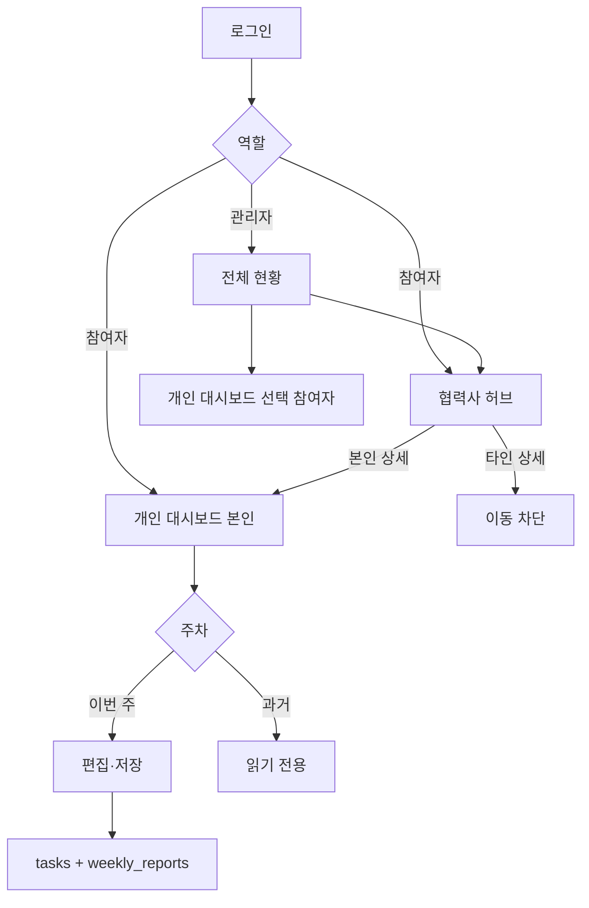

# AI 프로젝트 통합 대시보드 — UX 시나리오 설계서

| 항목 | 내용 |
|------|------|
| 문서 버전 | 1.0 |
| 기준 UI | `public/js/app.js` 최종 구현 |
| 작성일 | 2026-08-10 |
| 관련 문서 | [README.md](README.md), [개발계획서.md](개발계획서.md) |

---

## 1. 설계 목표

1. **역할이 즉시 구분**된다 — 로그인 탭(참여자 기본) → 사이드바 “참여자/관리자 모드”.
2. **주간 보고가 핵심 과업**이다 — 개인 대시보드에서 진척·요약·계획을 한 흐름으로 저장.
3. **과거와 현재를 헷갈리지 않는다** — 주차 선택, 이번 주만 편집, 과거는 읽기 전용.
4. **참여자 프라이버시** — 타 참여자 상세/수정 불가, 허브에서는 현황만 공유.
5. **관리자 운영 효율** — 협력사 패널·필터·삭제·피드백·PDF가 한 대시보드에 모인다.

---

## 2. 페르소나

### P1. 참여자 (컨설팅 과제 수행자)

- 목표: 이번 주 진척과 주간보고를 빠르게 제출하고, 지난 주 내용을 확인한다.
- 제약: 타 참여자 과제를 열어보거나 수정하면 안 된다.

### P2. 관리자/컨설턴트

- 목표: 협력사·참여자 진척을 모니터링하고, 피드백·공지·레포트를 발행한다.
- 제약: 참여자 주간보고 본문은 참여자가 작성; 관리자는 피드백·운영에 집중.

### P3. 협력사 PMO (간접)

- 목표: 허브 공지·참여자 업데이트 요청을 확인한다.
- 앱에서는 참여자/관리자 계정으로 간접 수행.

---

## 3. 정보 구조 (IA)

```
로그인
 ├─ 참여자 로그인 / 신규 등록
 └─ 관리자 로그인
        │
        ├─ [관리자] 전체 현황
        │     ├─ 통계 카드
        │     ├─ 협력사별 일정 관리 패널
        │     └─ 협력사/과제 리스트 (+ 필터)
        │
        ├─ 협력사 허브
        │     ├─ 운영 요약
        │     ├─ 공지사항
        │     ├─ 운영 체크
        │     └─ 과제별 진척현황
        │
        └─ 개인 대시보드
              ├─ (관리자) 참여자 전체 현황 선택
              ├─ 조회 주차
              ├─ 과제 목록
              └─ 주간 보고 폼
```

---

## 4. 공통 UX 원칙

| 원칙 | 적용 |
|------|------|
| 기본 탭 | 로그인 화면에서 **참여자** 탭이 왼쪽·기본 |
| 피드백 | 성공/실패는 toast, 차단성 안내는 `alert` |
| 상태 색 | 주간보고 작성완료=초록, 미작성=빨강 (`status-text`) |
| 읽기 전용 | `readonly` / `disabled` + 저장 버튼 숨김 |
| 빈 상태 | empty 문구로 다음 행동 유도 |

---

## 5. 시나리오 상세

### S1. 참여자 로그인 → 본인 대시보드

| 단계 | 사용자 행동 | 시스템 반응 |
|------|-------------|-------------|
| 1 | 참여자 탭에서 협력사·이름·이메일 입력 후 로그인 | 인증 성공 시 소속 협력사·본인 ID 고정 |
| 2 | 사이드바 「개인 대시보드」 | 본인 과제·보고만 표시 |
| 3 | (옵션) 협력사 허브 열람 | 동일 협력사 현황·공지 확인 가능 |

**성공 기준:** 타 참여자 데이터가 개인 대시보드에 노출되지 않음.

---

### S2. 이번 주 주간보고 작성·저장

| 단계 | 사용자 행동 | 시스템 반응 |
|------|-------------|-------------|
| 1 | 조회 주차 = 이번 주(기본) | 편집 가능 폼 표시, 「내 보고 저장」 노출 |
| 2 | 과제 선택, 진척 슬라이더 조정 | 목록 진척 바 동기화, debounce 저장(본인만) |
| 3 | 금주 요약·차주 계획 입력 | — |
| 4 | 「내 보고 저장」 | 둘 중 하나라도 비면 **alert** 후 저장 안 함 |
| 5 | 둘 다 입력 후 저장 | `tasks` + `task_weekly_reports` 스냅샷, 작성완료 뱃지 |

**성공 기준:** 저장 후 새로고침해도 동일 주차 스냅샷이 유지됨.

---

### S3. 과거 주차 조회

| 단계 | 사용자 행동 | 시스템 반응 |
|------|-------------|-------------|
| 1 | 조회 주차에서 과거 주 선택 | 폼·슬라이더 읽기 전용, 저장 버튼 숨김 |
| 2 | 스냅샷 있는 과제 | 당시 진척·요약·계획·피드백 표시 |
| 3 | 스냅샷 없는 과제 | 「해당 주 없음」 / 「저장된 주간 보고가 없습니다」 |

**성공 기준:** 과거 주에서 입력해도 persist되지 않음.  
**한계:** 기능 적용 **이전** 주는 복구 불가 — 이후 저장분만 이력.

---

### S4. 협력사 허브에서 상세보기 (권한)

| 단계 | 사용자 행동 | 시스템 반응 |
|------|-------------|-------------|
| 1 | 과제별 진척현황에서 본인 카드 「상세보기」 | 개인 대시보드로 이동, 해당 과제 선택 |
| 2 | 타인 카드 | 버튼 대신 「본인 과제만 상세 열람」 |
| 3 | (우회 시도) | alert: 본인만 열람 가능 |

**주간보고 상태 표시:**  
- 미작성 → 붉은 글자  
- 작성완료 → 초록 글자  

---

### S5. 관리자 — 모니터링·필터

| 단계 | 사용자 행동 | 시스템 반응 |
|------|-------------|-------------|
| 1 | 관리자 로그인 | 전체 현황 대시보드 |
| 2 | 협력사 패널 확인 | 일정·PMO·참여자수·**과제수** |
| 3 | 리스트에서 협력사/참여자/상태 필터 | 과제 있는 행만 표시, 조건 조합 필터 |
| 4 | 「상세」 | 해당 참여자 개인 대시보드(열람·피드백) |

**성공 기준:** 과제 미등록 참여자는 리스트에 나오지 않음.

---

### S6. 관리자 — 피드백·레포트

| 단계 | 사용자 행동 | 시스템 반응 |
|------|-------------|-------------|
| 1 | 참여자 선택 후 이번 주에서 피드백 작성 | 피드백 textarea 편집 가능 |
| 2 | 「피드백 저장」 | 스냅샷에도 피드백 반영 |
| 3 | 협력사 허브 「레포트 발행」 | PDF 생성 + publish 메타 기록 |

과거 주차에서는 피드백 저장 버튼 숨김/차단.

---

### S7. 관리자 — 협력사·과제 삭제

| 단계 | 사용자 행동 | 시스템 반응 |
|------|-------------|-------------|
| 1 | 협력사 삭제 / 과제 삭제 클릭 | confirm에 영향 범위(인원·과제 수) 안내 |
| 2 | 확인 | persist → Supabase cascade 삭제 |

---

### S8. 공지·참여자 업데이트 요청

| 단계 | 행위자 | 흐름 |
|------|--------|------|
| 공지 등록 | 관리자 | 허브에 공지 → 참여자는 제목 클릭으로 확인, 미확인 뱃지 |
| 업데이트 요청 | 관리자 | 「참여자 업데이트」 → 허브 진입 시 모달 → 확인/등록 |

---

## 6. 화면별 UI 스펙 (요약)

### 6.1 로그인

- 좌측 브랜드/여정, 우측 탭: **참여자 | 관리자**
- 관리자 화면에 비밀번호 힌트 문구를 노출하지 않음

### 6.2 관리자 · 협력사/과제 리스트 툴바

- 검색 입력
- 전체 협력사 select
- 전체 참여자 select (협력사 변경 시 참여자 필터 초기화)
- 전체 일정 상태 select
- “N건 표시 중”

### 6.3 개인 대시보드 · 주간 보고

- 조회 주차 select: `1주차 … N주차 (이번 주)`
- 과제 select + 진척 range
- 금주 요약 / 차주 계획 / 컨설턴트 피드백
- 저장: 참여자「내 보고 저장」 / 관리자「피드백 저장」(이번 주만)

---

## 7. 상태·예외 메시지

| 상황 | 메시지 유형 | 문구 예 |
|------|-------------|---------|
| 요약/계획 미입력 | alert | 금주 요약과 차주 계획을 모두 입력한 뒤 저장해 주세요. |
| 타 과제 상세 | alert | 본인 과제만 개인 대시보드에서 열람할 수 있습니다. |
| 과거 주 저장 시도 | toast | 과거 주차는 조회만 가능합니다… |
| 본인 외 보고 저장 | alert | 본인 주간 보고만 저장할 수 있습니다. |
| 필터 결과 없음 | empty | 조건에 맞는 과제가 없습니다. |
| 과거 주 스냅샷 없음 | empty | N주차에 저장된 주간 보고가 없습니다. |

---

## 8. 접근성·반응형 메모

- 주요 조작은 `button`/`select`/`label` 연결 유지
- 테이블은 `.table-scroll`로 가로 스크롤
- 모바일: 필터 select가 세로로 쌓이도록 기존 `.filters` 반응형 활용

---

## 9. 수용 기준 (Acceptance)

1. 참여자는 타인 상세보기·타인 보고 저장이 불가하다.  
2. 주간보고는 요약·계획 필수이며, 저장 시 해당 주차 스냅샷이 남는다.  
3. 과거 주차는 읽기 전용이다.  
4. 관리자 리스트는 과제 있는 행만 보이며, 협력사·참여자 필터가 동작한다.  
5. 허브 진척현황에서 주간보고 완료/미작성이 초록/빨강으로 구분된다.

---

## 10. 시나리오 흐름도 (요약)


